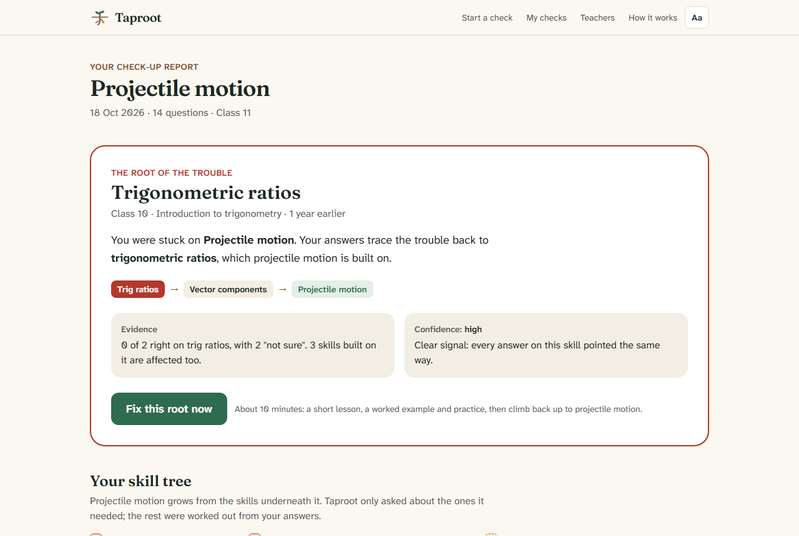
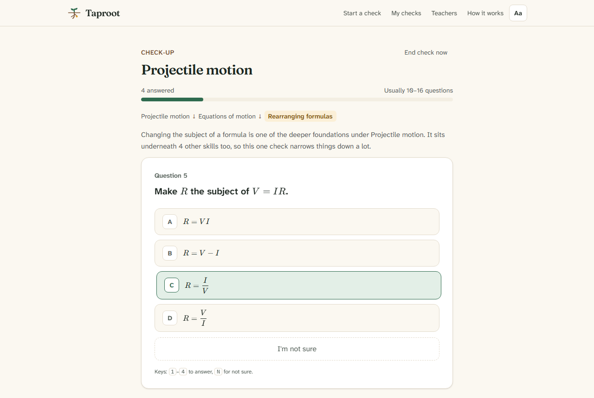
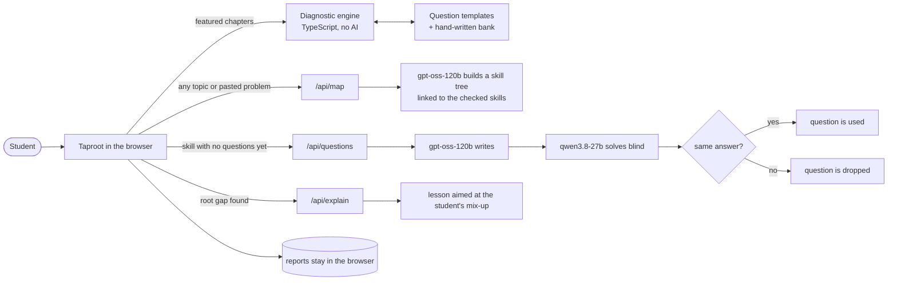

# Taproot: find the real reason you're stuck

Taproot is a five-minute check-up for maths and science. A student names the chapter they're stuck on, or pastes the exact problem they can't solve. Taproot then traces the trouble **down the tree of earlier skills the chapter is built on**, and shows the root gap where it starts and the mix-up behind it. Then it helps the student fix that skill and climb back up.

Built for **Craft N Code Karnataka 2026** (theme: AI for Education).

| | |
|---|---|
| **Live app** | https://craft-n-code-karnataka.vercel.app |
| **Demo video** | _added at submission_ |
| **Slides** | _added at submission_ |



---

## Problem and user

**User.** A student in Classes 8–12 in Karnataka (State Board, PUC or CBSE) who is stuck on a maths, physics or chemistry chapter. The second user is the teacher or tutor who wants to know *why* that student is stuck.

**Problem.** Maths and science are built in layers. When a student can't follow projectile motion, the cause is often not projectile motion. It's an older skill such as resolving vectors, trigonometric ratios, or rearranging a formula. Students respond by re-reading the chapter or watching more videos on it, which doesn't help, because the gap is somewhere else. School tests make this worse: they say a student is *weak in this chapter*, never *why*.

The evidence that these gaps are real and compound:

- **Maths scores fall as students move up.** The national average maths score drops from **57% in Class 3 to 44%, 36% and then 32% in Class 10** (National Achievement Survey 2021, Ministry of Education).
- **Students are years behind, and the gap grows.** In a randomised trial in Delhi, middle-school students were *several grade levels behind* in maths, and the gap widened every year (Muralidharan, Singh & Ganimian, *American Economic Review*, 2019).
- **Teaching at the right level works.** In the same trial, teaching each student at their actual level instead of their class level raised maths scores by **0.37 standard deviations in just 4.5 months**.

**What Taproot changes.** In about 14 questions a student learns where their trouble really starts, for example *"trigonometric ratios, from Class 10, and you're swapping sine and cosine"*. They then get a short repair aimed at that exact mix-up, with a path back up to the chapter they were stuck on. A teacher can make a class, and the class dashboard groups students' check-ups by root gap, so one lesson can fix the skill most of the class is missing.

---

## How it works



1. **Start.** Pick one of five featured chapters, type any maths or science topic, or paste a problem.
2. **Trace.** Answer about 10–16 one-tap questions. Each comes with a plain-language reason ("Projectile motion is built on vector components. Let's see whether the trouble starts here"). There is an **I'm not sure** option, because a guess makes the check less accurate. Answers stay hidden until the end: it's a check-up, not a test.
3. **Root found.** The report draws the chapter as a plant above the soil, with its prerequisite skills as roots below. It highlights the root gap and the path from the gap up to the chapter, and shows the evidence, the misconception detected and a confidence level.
4. **Repair and climb.** A short lesson aimed at the detected mix-up (written by AI, or Taproot's own curated lesson), a worked example and three practice questions. Then the student climbs skill by skill back up to the original chapter.
5. **Keep and share.** Reports are saved on the device. A student can print them, copy a text summary, or send a teacher a link. Taproot suggests a re-check three days later, because spaced practice helps it stick.
6. **Classes for teachers (optional).** The **Log in** page (`/login`) has two sides. A teacher signs in with email and password, makes classes and shares each one's six-character code. A student picks *Student* and enters the code, with no account or password. Each check-up a student finishes then adds its outcome (chapter, root gap, mix-up, confidence; never a name or answers) to the teacher's dashboard, which ranks the class's root gaps with the mix-ups behind them. Results are deleted after 90 days.

### The diagnostic engine (not AI: a transparent algorithm)

- **Skill trees.** Each featured chapter sits on a hand-built prerequisite tree of 10–22 skills, taken from a shared graph of 34 skills from Class 6 to Class 11.
- **Each skill is decided by weighing evidence.** It uses a *sequential probability ratio test* (Wald, 1945). A right answer is about 6× likelier from a student who knows the skill than from one guessing, and "I'm not sure" is strong evidence they don't. Taproot keeps asking about a skill until the odds pass about 20 : 1, which takes 2 to 4 questions.
- **A binary search.** Taproot searches underneath the *deepest failure that no confirmed root explains yet*, and asks about whichever skill best splits the remaining suspects. Passing a skill marks everything under it as solid. Failing a skill marks everything built on it as affected.
- **A check for a second gap.** Once every failure is explained, Taproot quickly checks the remaining sibling branches, so a second gap isn't missed.
- **The root gap** is a skill the student failed whose own foundations are solid.
- **Every wrong option is a diagnosis.** Questions for featured chapters come from 115 code templates with freshly computed numbers, so answers are always exactly right. Each wrong option is the answer a named misconception produces, such as adding fractions top-and-bottom or using ×3.6 to convert km/h into m/s. So Taproot can say *why*, not just *where*.

### Where AI comes in



- **Mapping any topic or problem.** The AI builds a small tree: the topic, 1–3 of its sub-skills (e.g. *nth term of an AP*), and links down into Taproot's checked foundations. Code then validates the tree: it drops unknown links, breaks cycles, removes unreachable nodes and caps sizes.
- **Writing questions, checked by a second model.** For skills without curated questions, `gpt-oss-120b` writes questions whose wrong options are tagged with misconceptions. A **different model family** (`qwen3.8-27b`) then solves them without the answer key. Only questions where both agree are shown, and they're labelled as AI-written.
- **Lessons aimed at the mix-up.** The repair lesson starts from what the student's actual wrong answers show they were thinking.
- **Within the free tier.** Outputs are strict JSON-schema, there's automatic fallback between models on a rate limit (waiting for Groq's `retry-after` if all are busy), background prefetching paced to the quota, per-IP rate limits and caching.
- **When AI is unavailable,** featured chapters still work end to end, with curated lessons.

**Tech:** Next.js 16 (App Router) · React 19 · Tailwind CSS 4 · TypeScript · KaTeX (maths, with MathML for screen readers) · dagre (tree layout) · zod · Groq SDK · Postgres on Neon (only for teacher accounts and classes). Hosted on Vercel's free tier. Students never need a login.

---

## Evidence it works

### 1. The diagnosis, tested on 10,000 simulated students

`npm run eval:sim` gives each of 2,000 simulated students per featured chapter 0–2 hidden gaps. Its student model has 10% careless slips, 40% "not sure" on unknown skills, and random guesses otherwise. Full tables are in [eval/results/simulation.md](eval/results/simulation.md).

| Method | First answer is the true root gap | Exactly right | False alarms (students with no gap) | Questions (avg) |
|---|---|---|---|---|
| **Taproot** | **85.4%** | **82.3%** | **1.0%** | **13.8** |
| Walk down one level at a time | 74.9% | 72.6% | 0.5% | 14.2 |
| Test every skill | 91.4% | 77.7% | 17.7% | 35.5 |
| A normal chapter test | 4.7% | 14.1% | 1.0% | 5.0 |

- **Error analysis changed the design.** About two-thirds of early misses came from lucky guesses. Switching from a fixed "2 out of 2" rule to the evidence test raised exact accuracy from 74.5% to 82.3%, for about one extra question.
- **Robustness checks:**
  - With gaps weighted towards later classes, it reaches 84.5% exact.
  - With slip rates of 5%, 10% and 20%, it scores 84.2%, 81.7% and 71.8%.
  - Raising the question budget beyond 20 adds under 1.5 points, so 20 is the default.
- **Limit:** this shows the method is sound. It is not yet evidence from real classrooms (see [Limits](#limits)).

### 2. The AI parts, tested against the live API

`npm run eval:llm` (results in [eval/results/llm.md](eval/results/llm.md)): 

| Check | Result |
|---|---|
| Independent checker catches planted wrong answer keys | 100% caught, 100% of correct keys kept (30 of 46 questions answered within quota) |
| AI-built skill trees vs hand-built ones | 92% precision, 75% recall on the linked foundations |
| AI-written questions passing the cross-check | 16 of 16, and a third model agreed on 14 of 16 (88%) |
| Refusals and prompt injection | 5 of 5 behaved as expected |
| Lesson format (maths renders, length limits) | 4 of 4 lessons within limits |

### 3. Automated tests

- **106 unit tests** (`npm test`). Every question template is run hundreds of times, with its answer recomputed independently and its LaTeX rendered. The skill graph is checked for missing links and cycles. The engine must find a gap planted at *any* skill in every featured chapter. The account and class APIs are tested end to end: password hashing, sign-in limits, cross-site request blocking, that one teacher can't open another's class, and that nothing identifying a student is stored. Their SQL was also run against a real Postgres engine.
- **27 browser tests on desktop and mobile** (`npm run e2e`). A scripted student with a planted gap takes a real check-up and must be diagnosed correctly. A teacher signs up and makes a class, a student in a separate browser joins it with the code and finishes a check-up, and the root gap must appear on the dashboard. Every page is scanned with axe for WCAG 2.1 AA issues, including dark mode. These tests found and fixed four real accessibility bugs.
- **A live AI end-to-end test** (`LIVE_AI=1`). A custom topic ("Arithmetic progressions") with a planted gap in the AI-made *nth term* skill: AI maps it, writes and cross-checks the questions, and the gap is found.

---

## Data and AI used

**Data, all authored for this project:**

| | |
|---|---|
| Skill graph | 34 skills (20 maths, 11 physics, 3 chemistry), Class 6–11, each with prerequisites, a summary, a short lesson and a syllabus reference (class and NCERT topic name) |
| Misconceptions | 103, each with a short fix. Wrong answer options are tagged with them |
| Questions | 115 code templates that generate fresh numbers and compute the answer exactly, plus 34 hand-written conceptual questions (e.g. *what is the acceleration at the top of a throw?*) |
| Featured chapters | Projectile motion (22-skill tree), resistors in series and parallel (17), heights and distances (14), quadratic equations (11), mole concept (10) |
| Evaluation data | Synthetic students only. **No real student data is collected or used.** |

The data was drafted with AI assistance (see below) and checked by automated tests: answers recomputed, LaTeX validated, every misconception reachable, graph acyclic. The team reviewed it as well.

**AI at runtime** (Groq, free tier; open-weight models):

| Model | Used for |
|---|---|
| `openai/gpt-oss-120b` | Mapping topics and problems to skill trees, writing questions, writing lessons |
| `qwen/qwen3.8-27b` | Independently solving AI-written questions (a different model family from the writer) |
| `openai/gpt-oss-20b` | Fallback when the others are rate-limited |

**Responsible use:**

- **What is sent to the AI.** Only the AI features send anything: the typed topic or problem, the skill being worked on, and the questions a student missed on that skill. Never a name or identifier. Taproot stores nothing on a server, and Groq states it doesn't retain inference data by default.
- **On the device.** Reports live in the browser, with a one-click delete.
- **Classes are opt-in and minimal.** Only a student who enters a class code sends anything about a check-up, and only its outcome: chapter, class year, root gap, mix-up label and confidence. The schema has no column for a name, answers, IP address or device, and extra fields are stripped on arrival. Results are deleted after 90 days, or at once when the teacher deletes the class. A student's optional nickname stays on their device.
- **Teacher accounts.** Only teachers (adults) have accounts: name, email and a salted scrypt password hash. Sessions are random tokens in an HttpOnly, SameSite cookie, stored server-side only as a SHA-256 hash. Sign-in attempts are rate-limited per visitor and per account, and requests that change data must come from the site itself.
- **Shared links.** These carry the result but not the answers, inside the part of the URL after `#`, which browsers never send to a server.
- **Prompt injection.** User text is treated as data in prompts, outputs are schema-constrained, KaTeX runs with `trust: false`, and React escapes all text.
- **Honest labels.** The app is open about uncertainty: every question has a reason, every result a confidence level, and AI content is labelled.
- **Accessibility:**
  - Full keyboard use (1–4 to answer, N for not sure).
  - Screen-reader friendly maths (MathML), and a list view of the tree.
  - Text size, easy-read spacing and dark mode.
  - The Atkinson Hyperlegible typeface, designed for low vision.
  - WCAG AA contrast, with status never shown by colour alone.
  - Reduced motion when the device asks for it.

---

## How to run it

You need **Node.js 22+**.

```bash
git clone https://github.com/aditya-sridhar-git/Craft-N-Code-Karnataka.git
cd Craft-N-Code-Karnataka
npm install
cp .env.example .env.local     # then add your free key from https://console.groq.com/keys
npm run dev                    # http://localhost:3000
```

Without a `GROQ_API_KEY`, the five featured chapters still work end to end with curated lessons. Custom topics and AI lessons need the key.

| Command | What it does |
|---|---|
| `npm test` | Unit tests (Vitest) |
| `npm run eval:sim` | Simulation evaluation → `eval/results/simulation.md` (no key needed) |
| `npm run eval:llm` | AI evaluation against the live API → `eval/results/llm.md` (needs the key) |
| `npx playwright install chromium && npm run build && npm run e2e` | Browser tests with accessibility scans |
| `LIVE_AI=1 npx playwright test live-ai --project=desktop` | End-to-end test with real AI |
| `npm run lint && npm run typecheck` | Static checks (also run in CI) |

**Deploy to Vercel:** the repository includes a `vercel.json`, so no settings need changing.

1. Import the repository on [vercel.com/new](https://vercel.com/new). The framework (Next.js) is detected automatically.
2. Under *Environment Variables*, add `GROQ_API_KEY` for Production and Preview. Never commit the key: `.env*` files are git-ignored.
3. For teacher accounts and classes, open the project's *Storage* tab → *Create Database* → **Neon** (Postgres, free plan), and connect it to the project. This sets `DATABASE_URL` automatically. The tables are created on first use, so there's no migration step.
4. Deploy (or redeploy, so the new variables apply).

Or from the command line: `npx vercel`, then `npx vercel env add GROQ_API_KEY`, add Neon in the dashboard as in step 3, and `npx vercel --prod`. API routes get a 60-second limit to ride out Groq rate-limit waits.

Without a database, everything except accounts and classes still works: the login page says they aren't switched on, and the join field is hidden. Locally, `npm run dev` uses an in-memory store, so accounts and classes work without any setup (they're lost on restart).

---

## AI tools and reused code

**AI tools used to build Taproot:**

- **Claude Code** (Anthropic's AI coding assistant) helped write the code, tests, skill data, evaluation scripts and documentation, under the team's direction and review.
- Commits it helped write carry a `Co-Authored-By: Claude` line.
- The runtime AI models are listed in [Data and AI used](#data-and-ai-used).

**Reused code:**

- The project was scaffolded with `create-next-app`. Everything else was written for this project; no code was copied from other projects.
- It uses these open-source packages through npm: Next.js, React, Tailwind CSS (MIT), KaTeX (MIT), @dagrejs/dagre (MIT), zod (MIT), lz-string (MIT), groq-sdk (Apache-2.0), server-only (MIT); and for development Vitest (MIT), Playwright (Apache-2.0), @axe-core/playwright (MPL-2.0), tsx (MIT), ESLint (MIT).
- Fonts: Atkinson Hyperlegible Next (Braille Institute, SIL OFL) and Fraunces (SIL OFL), self-hosted via `next/font`.

---

## Limits

- **Coverage.** Five chapters have hand-checked content. Other topics depend on AI: the skill tree for a custom topic isn't reviewed by a person, and although AI questions are cross-checked, they can still be wrong.
- **Guessing.** Multiple-choice answers can be guessed. "Not sure" and repeated questions reduce this but don't remove it: in simulation, about 1 diagnosis in 7 doesn't name the true root first.
- **Evidence so far is from simulation, not classrooms.** The next step is a pilot with real students, compared with teachers' judgement.
- **What it can't see.** Taproot finds missing skills. It can't see exam anxiety, reading or language difficulties, or speed.
- **English only** for now.
- **Teacher accounts are basic.** There's no password reset or email verification yet. A student's results only reach a class from the device where they joined it.
- **Free AI quota.** The hosted version uses Groq's free tier: about 8,000 tokens a minute per model. When it's busy, custom topics slow down or pause; featured chapters keep working.
- **A guide, not a grade.** A check-up says where to start learning. It says nothing about how able anyone is.

---

## Research

- Muralidharan, K., Singh, A., & Ganimian, A. J. (2019). Disrupting education? Experimental evidence on technology-aided instruction in India. *American Economic Review, 109*(4), 1426–1460.
- Ministry of Education (2021). *National Achievement Survey 2021.* nas.gov.in
- Wald, A. (1945). Sequential tests of statistical hypotheses. *Annals of Mathematical Statistics, 16*(2), 117–186.
- Doignon, J.-P., & Falmagne, J.-C. (1985). Spaces for the assessment of knowledge. *International Journal of Man-Machine Studies, 23*(2), 175–196.
- de la Torre, J. (2009). DINA model and parameter estimation: A didactic. *Journal of Educational and Behavioral Statistics, 34*(1), 115–130.
- Ausubel, D. P. (1968). *Educational Psychology: A Cognitive View.*

## Project layout

```
src/app/              routing only: pages and /api routes re-export from the layers below (Next.js requires this folder)
src/frontend/
  components/         shared UI pieces (question card, skill tree, report view, menus)
  features/           one folder per screen: home, about, start, check, report, repair, history, r (shared report), login (student and teacher), teacher (classes and dashboard)
  lib/                browser-side logic: check-up flow, session, local storage, share links, preferences
src/backend/
  handlers/           API request handlers: map, questions, explain, status, classes, teacher accounts
  db/                 accounts and class storage: Postgres (Neon) on Vercel, in memory for development and tests
  ai/                 Groq pipelines (pipeline.ts), JSON schemas and output cleaning
  lib/                Groq client with model fallback (llm.ts), rate limits and caching (guard.ts), teacher sign-in (auth.ts)
src/shared/           code both sides use: types, skill graph and question data, diagnostic engine, question templates
eval/                 simulation and AI evaluations, with results
tests/, e2e/          unit tests and browser tests
vercel.json           Vercel deployment settings
```

Dependencies only point one way: `frontend` and `backend` may import `shared`, never each other. ESLint enforces this.

## License

MIT
